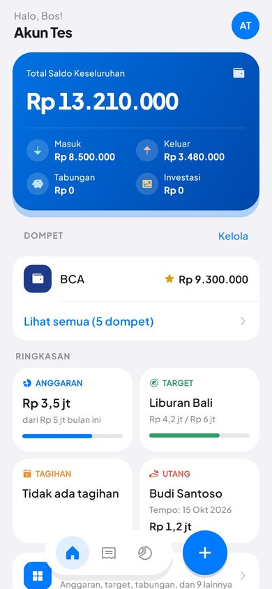
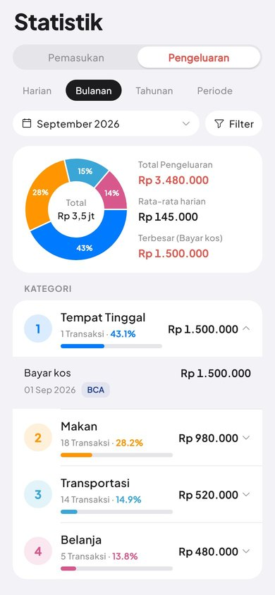
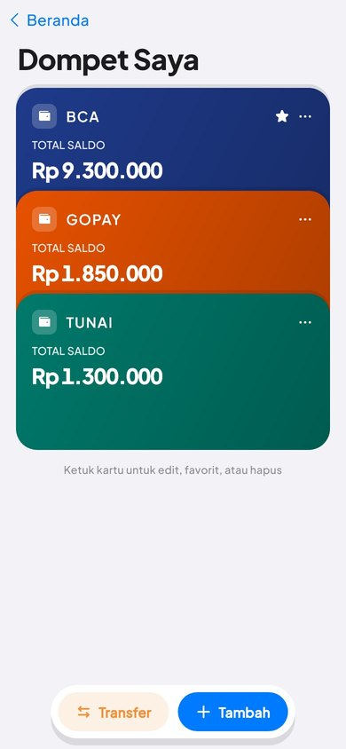
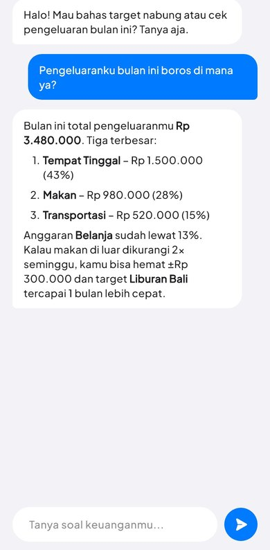

<p align="center">
  
</p>

<h1 align="center">Arthava</h1>

<p align="center">
  An open-source personal finance app built with Flutter and Supabase.<br>
  Track every wallet, plan budgets and savings, follow debts and investments, and ask an AI about your money.
</p>

<p align="center">
  <a href="LICENSE"></a>
  
  
  <a href="https://github.com/MiftahulH23/DompetKu/actions/workflows/ci.yml"></a>
</p>

<p align="center">
  
  
  
  
</p>

> *Arthava* comes from the Sanskrit **artha**, meaning wealth and prosperity.
> The app's interface is in Bahasa Indonesia and formats money as Rupiah.

---

## Contents

- [Features](#features)
- [Tech stack](#tech-stack)
- [Getting started](#getting-started)
  - [1. Prerequisites](#1-prerequisites)
  - [2. Clone and install](#2-clone-and-install)
  - [3. Create your Supabase backend](#3-create-your-supabase-backend)
  - [4. Configure your keys](#4-configure-your-keys)
  - [5. Run the app](#5-run-the-app)
- [Project structure](#project-structure)
- [Testing](#testing)
- [Contributing](#contributing)
- [Security](#security)
- [License](#license)

## Features

| Area | What you can do |
|---|---|
| **Transactions** | Log income and expenses by category and wallet, filter by day, month, year or a custom range, swipe a row to edit or delete it. |
| **Wallets** | Keep bank accounts, e-wallets and cash apart, transfer between them, mark favourites for the home screen, and set a minimum balance the app won't let you spend below. |
| **Statistics** | See spending by category with a donut chart, a daily average and your biggest expense for any period. |
| **Budgets** | Set a monthly limit per category and watch how much is left. Copy last month's budgets in one tap. |
| **Savings goals** | Create targets with a deadline. The app suggests how much to save each month. |
| **Savings books** | Separate savings pots you deposit into and withdraw from, each tied to a wallet. |
| **Recurring transactions** | Rent, salary and subscriptions post themselves when they're due. |
| **Financial calendar** | A month view of what came in and went out on each day. |
| **Investments** | Track stocks, crypto and mutual funds with capital, current value and return. |
| **Debts & receivables** | Record who owes whom, pay in installments, and get flagged when a payment is overdue. |
| **Ask AI** | Chat with an assistant (Google Gemini) that answers from your real wallets, budgets and goals. Scan a receipt to fill in a transaction. |
| **Zakat & charity** | Zakat maal calculator with a nisab check, and pay directly from a wallet. |
| **PDF reports** | Export a monthly or custom-range report ready to print. |
| **Biometric lock** | Open the app with fingerprint or face. |

## Tech stack

- **[Flutter](https://flutter.dev) 3.38** (Dart 3.10) for Android, iOS, web and desktop from one codebase.
- **[Riverpod 2](https://riverpod.dev)** for state. Each feature has a `NotifierProvider` that owns its queries.
- **[Supabase](https://supabase.com)**: Postgres, Auth (email and password) and Row Level Security so each user only sees their own rows.
- **Postgres functions (RPC)** for every balance change. Money moves inside one database transaction and is never read and then written back from the app.
- **[Google Gemini](https://ai.google.dev)** (`google_generative_ai`) for the AI assistant and the receipt scanner.
- **UI**: Material 3 styled to feel like iOS, [forui](https://forui.dev), [Phosphor icons](https://phosphoricons.com), Plus Jakarta Sans, `fl_chart`, `table_calendar`, `pdf`/`printing`, `local_auth`.

## Getting started

### 1. Prerequisites

| Tool | Version | Notes |
|---|---|---|
| Flutter SDK | **3.38.x** (stable) | `flutter --version`. Other versions may work but aren't tested. |
| A Supabase account | free tier is enough | [supabase.com](https://supabase.com) |
| Google AI Studio key | optional | Only for the AI chat and receipt scanner. [aistudio.google.com/apikey](https://aistudio.google.com/apikey) |
| Android Studio / Xcode | latest | Only for running on a phone or emulator. Chrome is enough to try the app. |

### 2. Clone and install

```bash
git clone https://github.com/MiftahulH23/DompetKu.git arthava
cd arthava
flutter pub get

# Enforce Conventional Commits on your commits (one time per clone)
git config core.hooksPath .githooks
```

### 3. Create your Supabase backend

Each contributor uses **their own** Supabase project, so you never touch anyone else's data.

1. Create a new project at [supabase.com/dashboard](https://supabase.com/dashboard). Pick a region close to you and save the database password.
2. Create the database. Open **SQL Editor** in the dashboard and run every file in [`supabase/migrations/`](supabase/migrations) **in filename order**, oldest first. The first one, `202610100000_baseline.sql`, creates all tables, Row Level Security policies, database functions, the sign-up trigger and the default categories. Any newer files add later changes on top. (Don't run the files in `supabase/archive/`, because the baseline already contains them.)

   If you use the [Supabase CLI](https://supabase.com/docs/guides/cli) instead:

   ```bash
   supabase login
   supabase link --project-ref YOUR-PROJECT-REF
   supabase db push
   ```

3. Configure sign-in. Go to **Authentication → Sign In / Providers → Email**. For local development, turn **Confirm email** off so new accounts can log in right away. Keep it on in production.
4. Copy your keys from **Project Settings → API**: the **Project URL** and the **anon public** key. The anon key is safe to ship in an app because Row Level Security protects the data. Never use the `service_role` key in the app.

### 4. Configure your keys

Keys are passed at build time with `--dart-define-from-file`. They are **not** stored in the source code.

```bash
cp env.example.json env.json
```

Then edit `env.json`:

```json
{
  "SUPABASE_URL": "https://abcdefghijklmnop.supabase.co",
  "SUPABASE_ANON_KEY": "eyJhbGciOi...",
  "GEMINI_API_KEY": "AIza..."
}
```

`env.json` is git-ignored, so don't commit it. `GEMINI_API_KEY` is optional. Without it the app works normally and only the AI features show a "not configured" message.

### 5. Run the app

```bash
# Fastest way to try it: a web build in Chrome
flutter run -d chrome --dart-define-from-file=env.json

# Android emulator or a phone with USB debugging
flutter run -d android --dart-define-from-file=env.json

# iOS simulator (macOS only)
flutter run -d ios --dart-define-from-file=env.json
```

Sign up with any email and password on the first screen, and you're in.

<details>
<summary>VS Code launch configuration</summary>

Add this to `.vscode/launch.json` so the Run button passes your keys:

```json
{
  "version": "0.2.0",
  "configurations": [
    {
      "name": "Arthava",
      "request": "launch",
      "type": "dart",
      "toolArgs": ["--dart-define-from-file=env.json"]
    }
  ]
}
```
</details>

<details>
<summary>Building a release</summary>

```bash
flutter build apk --release --dart-define-from-file=env.json      # Android APK
flutter build appbundle --release --dart-define-from-file=env.json # Play Store
flutter build ios --release --dart-define-from-file=env.json      # iOS (macOS only)
flutter build web --release --dart-define-from-file=env.json      # Web
```

Anything passed with `--dart-define` ends up inside the app binary. Treat the Gemini key as visible to anyone who has the app, and restrict it in Google Cloud (API restrictions and quotas) before you publish a build.
</details>

<details>
<summary>Troubleshooting</summary>

| Problem | Fix |
|---|---|
| `StateError: SUPABASE_URL / SUPABASE_ANON_KEY kosong` | You ran without `--dart-define-from-file=env.json`, or `env.json` is missing. |
| Sign-up works but login says the email isn't confirmed | Turn off **Confirm email** (step 3.3), or click the link in the email Supabase sent. |
| Empty home screen and errors in the console | A migration wasn't run, or they ran out of order. Run them again in filename order. |
| AI chat says it isn't configured | Add `GEMINI_API_KEY` to `env.json` and restart (hot reload doesn't reload defines). |
| `Unable to find suitable Visual Studio toolchain` | Windows desktop needs Visual Studio with "Desktop development with C++". Use Chrome or Android instead. |
</details>

## Project structure

```
lib/
├── main.dart            # Entry point: Supabase init, theme, first route
├── core/                # Colors, theme mode, env config, notifications, money rules
├── theme/               # forui theme and text styles (Plus Jakarta Sans)
├── models/              # Plain data classes with fromJson, one per table
├── providers/           # Riverpod notifiers; they own the Supabase queries
├── services/            # Gemini, PDF export, debt, zakat and report logic
├── screens/<feature>/   # One folder per feature, e.g. screens/budget/
└── widgets/             # Shared iOS-style components (AppPageScaffold, AppListRow, ...)

supabase/migrations/     # SQL: baseline schema plus every later change, in order
test/                    # Unit, widget, architecture, screenshot and E2E tests
tool/                    # E2E helper scripts and the screenshot font fetcher
docs/                    # Design notes, specs, database reference
```

[`AGENTS.md`](AGENTS.md) documents the conventions in detail: colors only from `AppColors`, shared modal components, Phosphor icons, and the rule that money changes go through database functions. It is written for AI coding assistants but it's the best guide for humans too.

## Testing

```bash
flutter analyze        # must show no errors or warnings
flutter test           # unit, widget and architecture tests (offline)
```

**Screenshot tests** render screens with the real font and save PNGs to `build/screenshots/`. They skip themselves until you fetch the font once:

```bash
sh tool/screenshots/fetch_fonts.sh
flutter test test/screenshots/
```

**End-to-end tests** run against **your own** Supabase project using a test account. They create temporary data and clean it up. Use a dedicated test user, not your real account.

```bash
E2E_EMAIL=test@example.com E2E_PASSWORD=your-test-password flutter test test/e2e/
E2E_EMAIL=test@example.com E2E_PASSWORD=your-test-password dart run tool/e2e/debt_rpc_e2e.dart
```

They read the Supabase URL and key from `env.json`, or from the `SUPABASE_URL` / `SUPABASE_ANON_KEY` environment variables. Without credentials they're skipped. CI runs `flutter analyze` and `flutter test` on every pull request.

## Contributing

Contributions are welcome, from typo fixes to new features. Read [CONTRIBUTING.md](CONTRIBUTING.md) first. In short:

1. Open an issue to discuss bigger changes before you build them.
2. Fork the repo and create a branch: `feat/short-name` or `fix/short-name`.
3. Keep `flutter analyze` and `flutter test` green and add tests for new behaviour.
4. Use [Conventional Commits](https://www.conventionalcommits.org) (`feat: ...`, `fix: ...`). The git hook checks this for you.
5. Open a pull request against `main`. The maintainer reviews and merges it.

## Security

Found a vulnerability? Please don't open a public issue. See [SECURITY.md](SECURITY.md).

## License

[MIT](LICENSE) © 2026 Miftahul Huda
